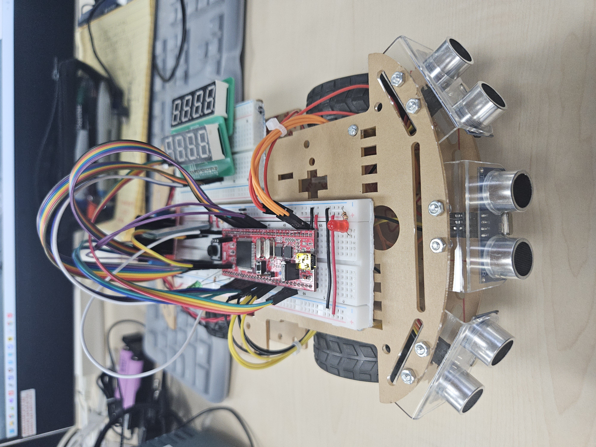

# ATmega128A-SmartCar

> **블루투스 수동 주행과 초음파 센서 자율 주행을 지원하는 ATmega128A 스마트카**

## 프로젝트 개요

스마트폰에서 블루투스로 문자를 보내 차량을 조작하는 수동 주행 모드와, 좌측·정면·우측 초음파 센서의 거리 값을 이용하는 자율 주행 모드를 구현했습니다. 버튼으로 동작 상태를 변경하고, FND에 주행 시간과 동작 상태 또는 동작 횟수를 표시합니다.

- **프로젝트 기간:** 2026.06.22 ~ 2026.06.24
- **Target MCU:** ATmega128A
- **IDE:** Microchip Studio
- **개발 언어:** C
- **주요 기능:** USART 통신, 초음파 거리 측정, PWM 모터 제어, 버튼 상태 전환, FND 및 LED 표시

---

## 차량 사진 및 주행 영상

[좌측 사진](images/좌측.jpg) · [우측 사진](images/우측.jpg) · [후면 사진](images/후면.jpg)

▶ [스마트카 주행 영상 보기](videos/SmartCar_주행영상.mp4)

---

## 주요 기능 및 동작

### 1. 블루투스 수동 주행

USART1 수신 인터럽트에서 스마트폰이 보낸 문자를 `bt_data`에 저장합니다. 수동 주행 상태에서는 이 값을 읽어 모터 동작을 결정합니다. 대문자와 소문자를 모두 받습니다.

| 입력 문자 | 동작 |
|---|---|
| `F` / `f` | 전진 |
| `B` / `b` | 후진 |
| `L` / `l` | 좌회전 |
| `R` / `r` | 우회전 |
| `S` / `s` | 정지 |

수신 문자는 확인을 위해 USART0으로도 전송합니다. 코드에서 USART0과 USART1은 9600bps로 설정했습니다.

### 2. 초음파 센서 자율 주행

좌측·정면·우측에 해당하는 초음파 센서 3개의 거리 값을 사용합니다. 각 센서의 Echo 신호는 외부 인터럽트 `INT4`~`INT6`에서 처리하며, Timer1 카운터 값으로 거리를 계산합니다.

| 거리 조건 | 주행 로직 |
|---|---|
| 정면 22cm 이상, 좌우 여유 있음 | 전진 |
| 정면 22cm 이상, 한쪽 측면 15cm 이하 | 장애물이 가까운 쪽의 반대 방향으로 보정 |
| 정면 22cm 미만, 좌우 모두 12cm 이하 | 후진 |
| 정면 22cm 미만, 한쪽 측면에 여유 있음 | 좌우 거리 비교 후 회전 방향 결정 |
| 회전 중 정면 35cm 이상 | 회전 상태 해제 |

좌회전과 우회전은 한쪽 바퀴의 PWM 값을 0으로 설정하고 다른 쪽 바퀴를 구동하는 방식으로 구현했습니다. 자율 주행 상태로 진입하면 `PG3` LED를 켜고, 해당 상태를 벗어나 다음 상태가 되면 LED를 끕니다.

### 3. 버튼 상태 전환 및 FND 표시

`PG0` 버튼을 눌렀다 떼면 상태 값이 `0`부터 `7`까지 순환합니다. 메인 루프는 상태 `0`에서 수동 주행 함수를, 상태 `4`에서 자율 주행 함수를 호출합니다. 상태 `1` ~ `3`, `5` ~ `7`에서는 모드별 주행이 끝난 후 후진·좌회전·우회전 횟수를 FND에 표시합니다.

Timer0 오버플로 인터럽트에서 시간 값을 갱신하고 FND를 순차 구동합니다. 첫 번째 FND에는 주행 시간을, 두 번째 FND에는 주행 중일 때는 주행 상태를, 주행이 끝난 후에는 동작 횟수를 표시하도록 구성했습니다.

---

## 하드웨어 핀 맵

| 기능 | ATmega128A 핀 | 코드에서의 역할 |
|---|---|---|
| 버튼 | `PG0` | 상태 전환 입력 |
| 상태 LED | `PG3` | 자율 주행 상태 진입·이탈 시 제어 |
| 왼쪽 / 오른쪽 모터 PWM | `PB5` / `PB6` | Timer1 `OC1A` / `OC1B` |
| 모터 방향 | `PF0`~`PF3` | 모터 드라이버 방향 입력 |
| 초음파 Trigger | `PA0` / `PA1` / `PA2` | 좌측 / 정면 / 우측 |
| 초음파 Echo | `PE4` / `PE5` / `PE6` | `INT4` / `INT5` / `INT6` |
| FND 세그먼트 데이터 | `PC0`~`PC7` | 표시 데이터 |
| FND1 / FND2 자리 선택 | `PD4`~`PD7` / `PF4`~`PF7` | 표시 자리 선택 |

---

## 파일 구조 및 역할

| 파일 | 역할 |
|---|---|
| `main.c` | 주변 장치 초기화, 버튼 상태 관리, 주행 함수 호출 |
| `mode.c` | 수동 주행 명령 처리와 자율 주행 방향 결정 |
| `pwm.c` | Timer1 PWM 설정, 모터 방향 및 속도 제어 |
| `ultrasonic.c` | 초음파 Trigger 생성, Echo 인터럽트 처리, 거리 계산 |
| `uart1.c` | 블루투스 문자 수신 |
| `uart0.c` | 확인용 시리얼 송수신 |
| `button.c` | 버튼 입력 판별 |
| `fnd.c` | 주행 시간, 주행 상태 및 동작 횟수 표시 |
| `led.c` | 상태 LED 초기화 및 켜기·끄기 |

C 소스와 헤더 파일은 `ATmega128A_SmartCar/` 디렉터리에 있으며, 사진과 영상은 각각 `images/`, `videos/` 디렉터리에 있습니다.
